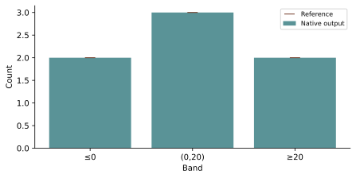

# Control flow and boundary cases

Assign each observation to a band, including the observations exactly on a boundary.

Use three disjoint intervals. Values at or below zero enter the first band. Positive values below 20 enter the second. Everything at or above 20 enters the last band. Summing the band counts gives a conservation check that catches dropped observations, although it cannot by itself detect a misplaced observation.

A lambda captures the classification rule locally. at checks the selected index before the counter is incremented.

[Worked notebook](lesson.ipynb) · [Python script](lesson.py)

[native.cpp](native.cpp)

## Execute the native listing

A lambda captures the classification rule locally. at checks the selected index before the counter is incremented. Look at the lifetime of each object and the owner of its storage. Passing a const reference permits observation without copying the container. Algorithms operate on half-open iterator ranges.

## Read the output

Read each bar as a count. A boundary convention is part of the specification and should be stated before choosing the test inputs. The marks show the independent Python reference at each position.

## Recorded output

```text
Runtime: C++
Native stdout: 2 3 2
Largest absolute difference: 0
```

## Interpreting the result

Read each bar as a count. A boundary convention is part of the specification and should be stated before choosing the test inputs.



## Exercise

Add values 19 and 20, then predict which two bars change. Test a list that leaves a category empty.

## References

[C++ language and standard library reference](https://en.cppreference.com/w/cpp)
