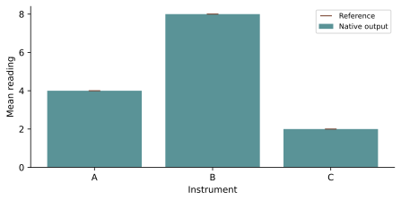

# Records and missing values

Compute mean readings by instrument while retaining the difference between zero and an absent reading.

Define the unit of observation before grouping. Each row is one reading from one instrument. The correct denominator is the number of observed values for that instrument. A measurement of zero belongs in that denominator. The result is ordered by identifier so it can be compared independently of map iteration order.

optional represents absence independently from zero. Structured bindings expose the accumulator and std::map iterates in key order.

[Worked notebook](lesson.ipynb) · [Python script](lesson.py)

[native.cpp](native.cpp)

## Execute the native listing

optional represents absence independently from zero. Structured bindings expose the accumulator and std::map iterates in key order. Look at the lifetime of each object and the owner of its storage. Passing a const reference permits observation without copying the container. Algorithms operate on half-open iterator ranges.

## Read the output

Instrument B has one observed value and one missing value. Its average stays at eight. An empty instrument would need an explicit missing-output convention. The marks show the independent Python reference at each position.

## Recorded output

```text
Runtime: C++
Native stdout: 4 8 2
Largest absolute difference: 0
```

## Interpreting the result

Instrument B has one observed value and one missing value. Its average stays at eight. An empty instrument would need an explicit missing-output convention.



## Exercise

Add a genuine zero to B and a new instrument with no observed values. Decide on a representation for the empty result.

## References

[C++ language and standard library reference](https://en.cppreference.com/w/cpp)
