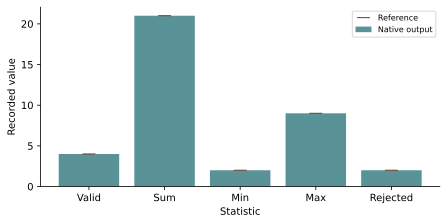

# File input and validation

Read a one-column file and report the valid count, sum, range and number of rejected records.

The supplied CSV has a header and short, unquoted single-field rows. It contains four small integers and two nonnumeric tokens. Keep data-reading errors distinct from bad fields. A rejected row should be counted exactly once and excluded from every numeric statistic. General CSV with embedded commas or quoted newlines needs a CSV parser.

ifstream closes its handle by RAII. from_chars returns both an error code and an end pointer, so a partially parsed token can be rejected.

[Worked notebook](lesson.ipynb) · [Python script](lesson.py)

[native.cpp](native.cpp) · [readings.csv](readings.csv)

## Execute the native listing

ifstream closes its handle by RAII. from_chars returns both an error code and an end pointer, so a partially parsed token can be rejected. Look at the lifetime of each object and the owner of its storage. Passing a const reference permits observation without copying the container. Algorithms operate on half-open iterator ranges.

## Read the output

The first statistic counts accepted rows and the last counts rejected rows. Together they must account for all six input observations. The sum and extrema refer to accepted rows only. The marks show the independent Python reference at each position.

## Recorded output

```text
Runtime: C++
Native stdout: 4 21 2 9 2
Largest absolute difference: 0
```

## Interpreting the result

The first statistic counts accepted rows and the last counts rejected rows. Together they must account for all six input observations. The sum and extrema refer to accepted rows only.



## Exercise

Insert another malformed row, rerun and compare the counts. Define an explicit policy for a file with no valid rows.

## References

[C++ language and standard library reference](https://en.cppreference.com/w/cpp)
