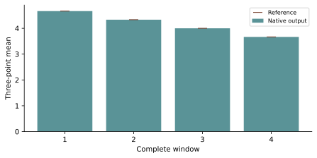

# RAII and class invariants

Follow a feature that shapes how this language is used in practice.

Work with a small fixture so that every returned value can be checked by hand. Keep the ordering of inputs visible. Trace resource ownership, data shape or scheduling as appropriate, and identify the exact point where the result becomes available to the caller.

A deque and its running total are owned by a class. The constructor enforces a positive width and value checks that the window is complete.

[Worked notebook](lesson.ipynb) · [Python script](lesson.py)

[native.cpp](native.cpp)

## Execute the native listing

A deque and its running total are owned by a class. The constructor enforces a positive width and value checks that the window is complete. Look at the lifetime of each object and the owner of its storage. Passing a const reference permits observation without copying the container. Algorithms operate on half-open iterator ranges.

## Read the output

The independent calculation describes the expected output. Its agreement with the native result tests both the values and their order. The marks show the independent Python reference at each position.

## Recorded output

```text
Runtime: C++
Native stdout: 4.66666666667 4.33333333333 4 3.66666666667
Largest absolute difference: 3.33e-12
```

## Interpreting the result

The independent calculation describes the expected output. Its agreement with the native result tests both the values and their order.



## Exercise

Change the input length, add a repeated value and predict all output positions before running the programme.

## References

[C++ language and standard library reference](https://en.cppreference.com/w/cpp)
