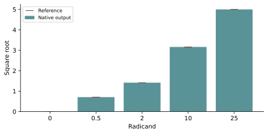

# Bisection and numerical functions

Approximate square roots by repeatedly halving a bracket.

For positive n, the target root lies in [0, max(1,n)]. The square is monotone there, so the comparison with n selects the half that still contains the root. Each exact-arithmetic iteration halves the interval width. In floating-point arithmetic two endpoints eventually round to the same value. Zero has a simple exact answer.

The Boolean result carries success. An output pointer carries the computed value on the success path.

[Worked notebook](lesson.ipynb) · [Python script](lesson.py)

[native.c](native.c)

## Execute the native listing

The Boolean result carries success. An output pointer carries the computed value on the success path. Track object lifetime, element count and representation separately. Bounds do not automatically travel with a pointer. Compiler warnings help expose conversions that deserve inspection.

## Read the output

Accuracy should be checked against an independent implementation on both sides of one. A fixed number of bisection steps is adequate for this small range. The marks show the independent Python reference at each position.

## Recorded output

```text
Runtime: C
Native stdout: 0 0.707106781187 1.41421356237 3.16227766017 5
Largest absolute difference: 3.1e-12
```

## Interpreting the result

Accuracy should be checked against an independent implementation on both sides of one. A fixed number of bisection steps is adequate for this small range.



## Exercise

Test 0.01, 1 and a larger value. Replace the fixed iteration count with an absolute or relative tolerance and justify the stopping condition.

## References

[C language reference and standard revisions](https://en.cppreference.com/w/c/language)
