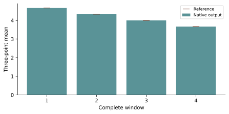

# Dynamic allocation and ownership

Follow a feature that shapes how this language is used in practice.

Work with a small fixture so that every returned value can be checked by hand. Keep the ordering of inputs visible. Trace resource ownership, data shape or scheduling as appropriate, and identify the exact point where the result becomes available to the caller.

The output buffer is allocated once, sized for the number of complete windows and released when printing is finished. A running sum avoids rescanning the window.

[Worked notebook](lesson.ipynb) · [Python script](lesson.py)

[native.c](native.c)

## Execute the native listing

The output buffer is allocated once, sized for the number of complete windows and released when printing is finished. A running sum avoids rescanning the window. Track object lifetime, element count and representation separately. Bounds do not automatically travel with a pointer. Compiler warnings help expose conversions that deserve inspection.

## Read the output

The independent calculation describes the expected output. Its agreement with the native result tests both the values and their order. The marks show the independent Python reference at each position.

## Recorded output

```text
Runtime: C
Native stdout: 4.66666666667 4.33333333333 4 3.66666666667
Largest absolute difference: 3.33e-12
```

## Interpreting the result

The independent calculation describes the expected output. Its agreement with the native result tests both the values and their order.



## Exercise

Change the input length, add a repeated value and predict all output positions before running the programme.

## References

[C language reference and standard revisions](https://en.cppreference.com/w/c/language)
