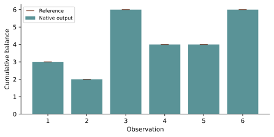

# Collections and prefix sums

Keep the balance after every signed change, including a negative change and a zero.

After processing position i, the state equals the sum of the first i changes. That invariant gives a proof by induction and a simple reference implementation. A one-pass algorithm costs linear time. Computing each prefix separately costs quadratic time but is convenient for checking six short observations.

A slice descriptor carries length and capacity. make allocates a distinct result slice so callers can still use their input.

[Worked notebook](lesson.ipynb) · [Python script](lesson.py)

[native.go](native.go)

## Execute the native listing

A slice descriptor carries length and capacity. make allocates a distinct result slice so callers can still use their input. Trace the result and error at the point where each function returns. Slice length, map lookup status and channel synchronisation are explicit parts of the interface.

## Read the output

A flat section corresponds to a zero change. The final balance must equal the sum of the full input even when earlier balances fall. The marks show the independent Python reference at each position.

## Recorded output

```text
Runtime: Go
Native stdout: 3 2 6 4 4 6
Largest absolute difference: 0
```

## Interpreting the result

A flat section corresponds to a zero change. The final balance must equal the sum of the full input even when earlier balances fall.



## Exercise

Insert a negative change at the start. Verify both the prefix values and the final-sum property.

## References

[The Go Programming Language Specification](https://go.dev/ref/spec)
