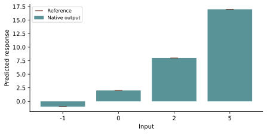

# Goroutines and ordered collection

Follow a feature that shapes how this language is used in practice.

Work with a small fixture so that every returned value can be checked by hand. Keep the ordering of inputs visible. Trace resource ownership, data shape or scheduling as appropriate, and identify the exact point where the result becomes available to the caller.

Workers send a position along with each result. The receiver writes into an indexed slice, so the printed order is independent of scheduling.

[Worked notebook](lesson.ipynb) · [Python script](lesson.py)

[native.go](native.go)

## Execute the native listing

Workers send a position along with each result. The receiver writes into an indexed slice, so the printed order is independent of scheduling. Trace the result and error at the point where each function returns. Slice length, map lookup status and channel synchronisation are explicit parts of the interface.

## Read the output

The independent calculation describes the expected output. Its agreement with the native result tests both the values and their order. The marks show the independent Python reference at each position.

## Recorded output

```text
Runtime: Go
Native stdout: -1 2 8 17
Largest absolute difference: 0
```

## Interpreting the result

The independent calculation describes the expected output. Its agreement with the native result tests both the values and their order.



## Exercise

Change the input length, add a repeated value and predict all output positions before running the programme.

## References

[The Go Programming Language Specification](https://go.dev/ref/spec)
