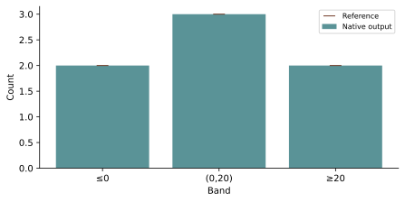

# Control flow and boundary cases

Assign each observation to a band, including the observations exactly on a boundary.

Use three disjoint intervals. Values at or below zero enter the first band. Positive values below 20 enter the second. Everything at or above 20 enters the last band. Summing the band counts gives a conservation check that catches dropped observations, although it cannot by itself detect a misplaced observation.

for...of visits values. A nested conditional assigns exactly one integer index before the counter is changed.

[Worked notebook](lesson.ipynb) · [Python script](lesson.py)

[native.js](native.js)

## Execute the native listing

for...of visits values. A nested conditional assigns exactly one integer index before the counter is changed. Distinguish a value from the Promise or iterator that may eventually produce it. The examples use Node.js for file access and the standard language for the calculations.

## Read the output

Read each bar as a count. A boundary convention is part of the specification and should be stated before choosing the test inputs. The marks show the independent Python reference at each position.

## Recorded output

```text
Runtime: Node.js
Native stdout: 2 3 2
Largest absolute difference: 0
```

## Interpreting the result

Read each bar as a count. A boundary convention is part of the specification and should be stated before choosing the test inputs.



## Exercise

Add values 19 and 20, then predict which two bars change. Test a list that leaves a category empty.

## References

[MDN, JavaScript Guide](https://developer.mozilla.org/en-US/docs/Web/JavaScript/Guide)
