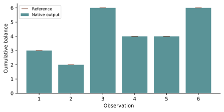

# Collections and prefix sums

Keep the balance after every signed change, including a negative change and a zero.

After processing position i, the state equals the sum of the first i changes. That invariant gives a proof by induction and a simple reference implementation. A one-pass algorithm costs linear time. Computing each prefix separately costs quadratic time but is convenient for checking six short observations.

A generator function pauses at yield. Spreading a generator into console.log consumes it in order.

[Worked notebook](lesson.ipynb) · [Python script](lesson.py)

[native.js](native.js)

## Execute the native listing

A generator function pauses at yield. Spreading a generator into console.log consumes it in order. Distinguish a value from the Promise or iterator that may eventually produce it. The examples use Node.js for file access and the standard language for the calculations.

## Read the output

A flat section corresponds to a zero change. The final balance must equal the sum of the full input even when earlier balances fall. The marks show the independent Python reference at each position.

## Recorded output

```text
Runtime: Node.js
Native stdout: 3 2 6 4 4 6
Largest absolute difference: 0
```

## Interpreting the result

A flat section corresponds to a zero change. The final balance must equal the sum of the full input even when earlier balances fall.



## Exercise

Insert a negative change at the start. Verify both the prefix values and the final-sum property.

## References

[MDN, JavaScript Guide](https://developer.mozilla.org/en-US/docs/Web/JavaScript/Guide)
