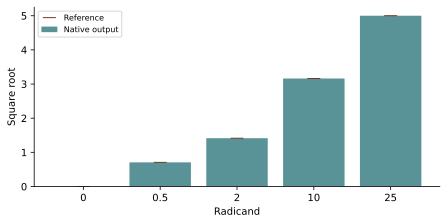

# Bisection and numerical functions

Approximate square roots by repeatedly halving a bracket.

For positive n, the target root lies in [0, max(1,n)]. The square is monotone there, so the comparison with n selects the half that still contains the root. Each exact-arithmetic iteration halves the interval width. In floating-point arithmetic two endpoints eventually round to the same value. Zero has a simple exact answer.

A finite-number guard limits the accepted input. A RangeError separates a domain problem from a successful numeric return.

[Worked notebook](lesson.ipynb) · [Python script](lesson.py)

[native.js](native.js)

## Execute the native listing

A finite-number guard limits the accepted input. A RangeError separates a domain problem from a successful numeric return. Distinguish a value from the Promise or iterator that may eventually produce it. The examples use Node.js for file access and the standard language for the calculations.

## Read the output

Accuracy should be checked against an independent implementation on both sides of one. A fixed number of bisection steps is adequate for this small range. The marks show the independent Python reference at each position.

## Recorded output

```text
Runtime: Node.js
Native stdout: 0 0.7071067811865475 1.414213562373095 3.162277660168379 5
Largest absolute difference: 4.44e-16
```

## Interpreting the result

Accuracy should be checked against an independent implementation on both sides of one. A fixed number of bisection steps is adequate for this small range.



## Exercise

Test 0.01, 1 and a larger value. Replace the fixed iteration count with an absolute or relative tolerance and justify the stopping condition.

## References

[MDN, JavaScript Guide](https://developer.mozilla.org/en-US/docs/Web/JavaScript/Guide)
