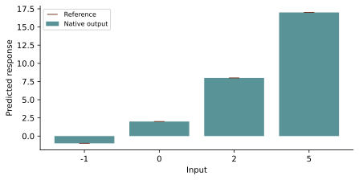

# Promises and result ordering

Follow a feature that shapes how this language is used in practice.

Work with a small fixture so that every returned value can be checked by hand. Keep the ordering of inputs visible. Trace resource ownership, data shape or scheduling as appropriate, and identify the exact point where the result becomes available to the caller.

Promise.all returns results in input order once the promises settle. Each asynchronous calibration here has a deterministic value independent of completion order.

[Worked notebook](lesson.ipynb) · [Python script](lesson.py)

[native.js](native.js)

## Execute the native listing

Promise.all returns results in input order once the promises settle. Each asynchronous calibration here has a deterministic value independent of completion order. Distinguish a value from the Promise or iterator that may eventually produce it. The examples use Node.js for file access and the standard language for the calculations.

## Read the output

The independent calculation describes the expected output. Its agreement with the native result tests both the values and their order. The marks show the independent Python reference at each position.

## Recorded output

```text
Runtime: Node.js
Native stdout: -1 2 8 17
Largest absolute difference: 0
```

## Interpreting the result

The independent calculation describes the expected output. Its agreement with the native result tests both the values and their order.



## Exercise

Change the input length, add a repeated value and predict all output positions before running the programme.

## References

[MDN, JavaScript Guide](https://developer.mozilla.org/en-US/docs/Web/JavaScript/Guide)
