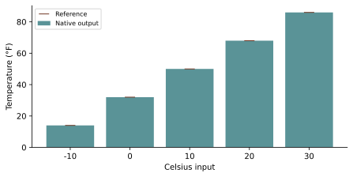

# Values and numeric types

Convert five readings from Celsius to Fahrenheit and examine where arithmetic changes type.

The offset belongs after multiplication by the scale factor. Check the freezing point by hand, then inspect a value that would expose early integer division. All plotted points share the same transformation, so equal increments on the input scale must give equal increments on the output scale.

Element-wise multiplication and division preserve the row-vector layout. fprintf consumes the vector in column-major order.

[Worked notebook](lesson.ipynb) · [Python script](lesson.py)

[native.m](native.m)

## Execute the native listing

Element-wise multiplication and division preserve the row-vector layout. fprintf consumes the vector in column-major order. Write down each array shape and distinguish element-wise arithmetic from matrix operations. The source uses the common MATLAB and GNU Octave language subset.

## Read the output

A straight line is expected. The intercept is 32 and a ten-degree Celsius step adds 18 degrees Fahrenheit. The marks show the independent Python reference at each position.

## Recorded output

```text
Runtime: GNU Octave (MATLAB-compatible source)
Native stdout: 14 32 50 68 86
Largest absolute difference: 0
```

## Interpreting the result

A straight line is expected. The intercept is 32 and a ten-degree Celsius step adds 18 degrees Fahrenheit.



## Exercise

Add −40 and a fractional Celsius reading. Describe any type change needed by the native programme.

## References

[MathWorks, MATLAB language fundamentals](https://www.mathworks.com/help/matlab/language-fundamentals.html)

[GNU Octave manual](https://docs.octave.org/latest/)
