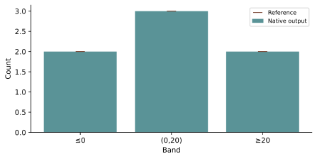

# Control flow and boundary cases

Assign each observation to a band, including the observations exactly on a boundary.

Use three disjoint intervals. Values at or below zero enter the first band. Positive values below 20 enter the second. Everything at or above 20 enters the last band. Summing the band counts gives a conservation check that catches dropped observations, although it cannot by itself detect a misplaced observation.

Logical masks select values in each interval. The sum of a logical mask is the number of true entries.

[Worked notebook](lesson.ipynb) · [Python script](lesson.py)

[native.m](native.m)

## Execute the native listing

Logical masks select values in each interval. The sum of a logical mask is the number of true entries. Write down each array shape and distinguish element-wise arithmetic from matrix operations. The source uses the common MATLAB and GNU Octave language subset.

## Read the output

Read each bar as a count. A boundary convention is part of the specification and should be stated before choosing the test inputs. The marks show the independent Python reference at each position.

## Recorded output

```text
Runtime: GNU Octave (MATLAB-compatible source)
Native stdout: 2 3 2
Largest absolute difference: 0
```

## Interpreting the result

Read each bar as a count. A boundary convention is part of the specification and should be stated before choosing the test inputs.



## Exercise

Add values 19 and 20, then predict which two bars change. Test a list that leaves a category empty.

## References

[MathWorks, MATLAB language fundamentals](https://www.mathworks.com/help/matlab/language-fundamentals.html)

[GNU Octave manual](https://docs.octave.org/latest/)
