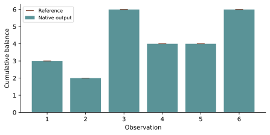

# Collections and prefix sums

Keep the balance after every signed change, including a negative change and a zero.

After processing position i, the state equals the sum of the first i changes. That invariant gives a proof by induction and a simple reference implementation. A one-pass algorithm costs linear time. Computing each prefix separately costs quadratic time but is convenient for checking six short observations.

cumsum preserves the position of each partial result. end indexes the last element without requiring a hard-coded length.

[Worked notebook](lesson.ipynb) · [Python script](lesson.py)

[native.m](native.m)

## Execute the native listing

cumsum preserves the position of each partial result. end indexes the last element without requiring a hard-coded length. Write down each array shape and distinguish element-wise arithmetic from matrix operations. The source uses the common MATLAB and GNU Octave language subset.

## Read the output

A flat section corresponds to a zero change. The final balance must equal the sum of the full input even when earlier balances fall. The marks show the independent Python reference at each position.

## Recorded output

```text
Runtime: GNU Octave (MATLAB-compatible source)
Native stdout: 3 2 6 4 4 6
Largest absolute difference: 0
```

## Interpreting the result

A flat section corresponds to a zero change. The final balance must equal the sum of the full input even when earlier balances fall.



## Exercise

Insert a negative change at the start. Verify both the prefix values and the final-sum property.

## References

[MathWorks, MATLAB language fundamentals](https://www.mathworks.com/help/matlab/language-fundamentals.html)

[GNU Octave manual](https://docs.octave.org/latest/)
