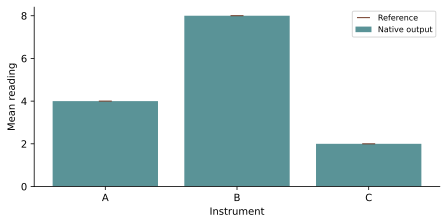

# Records and missing values

Compute mean readings by instrument while retaining the difference between zero and an absent reading.

Define the unit of observation before grouping. Each row is one reading from one instrument. The correct denominator is the number of observed values for that instrument. A measurement of zero belongs in that denominator. The result is ordered by identifier so it can be compared independently of map iteration order.

accumarray maps positive integer group indices to an output vector. Filter NaNs before forming both the sum and the denominator.

[Worked notebook](lesson.ipynb) · [Python script](lesson.py)

[native.m](native.m)

## Execute the native listing

accumarray maps positive integer group indices to an output vector. Filter NaNs before forming both the sum and the denominator. Write down each array shape and distinguish element-wise arithmetic from matrix operations. The source uses the common MATLAB and GNU Octave language subset.

## Read the output

Instrument B has one observed value and one missing value. Its average stays at eight. An empty instrument would need an explicit missing-output convention. The marks show the independent Python reference at each position.

## Recorded output

```text
Runtime: GNU Octave (MATLAB-compatible source)
Native stdout: 4 8 2
Largest absolute difference: 0
```

## Interpreting the result

Instrument B has one observed value and one missing value. Its average stays at eight. An empty instrument would need an explicit missing-output convention.



## Exercise

Add a genuine zero to B and a new instrument with no observed values. Decide on a representation for the empty result.

## References

[MathWorks, MATLAB language fundamentals](https://www.mathworks.com/help/matlab/language-fundamentals.html)

[GNU Octave manual](https://docs.octave.org/latest/)
