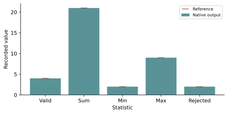

# File input and validation

Read a one-column file and report the valid count, sum, range and number of rejected records.

The supplied CSV has a header and short, unquoted single-field rows. It contains four small integers and two nonnumeric tokens. Keep data-reading errors distinct from bad fields. A rejected row should be counted exactly once and excluded from every numeric statistic. General CSV with embedded commas or quoted newlines needs a CSV parser.

fgetl reads one line without the newline. onCleanup pairs resource release with the scope in which the handle is held.

[Worked notebook](lesson.ipynb) · [Python script](lesson.py)

[native.m](native.m) · [readings.csv](readings.csv)

## Execute the native listing

fgetl reads one line without the newline. onCleanup pairs resource release with the scope in which the handle is held. Write down each array shape and distinguish element-wise arithmetic from matrix operations. The source uses the common MATLAB and GNU Octave language subset.

## Read the output

The first statistic counts accepted rows and the last counts rejected rows. Together they must account for all six input observations. The sum and extrema refer to accepted rows only. The marks show the independent Python reference at each position.

## Recorded output

```text
Runtime: GNU Octave (MATLAB-compatible source)
Native stdout: 4 21 2 9 2
Largest absolute difference: 0
```

## Interpreting the result

The first statistic counts accepted rows and the last counts rejected rows. Together they must account for all six input observations. The sum and extrema refer to accepted rows only.



## Exercise

Insert another malformed row, rerun and compare the counts. Define an explicit policy for a file with no valid rows.

## References

[MathWorks, MATLAB language fundamentals](https://www.mathworks.com/help/matlab/language-fundamentals.html)

[GNU Octave manual](https://docs.octave.org/latest/)
