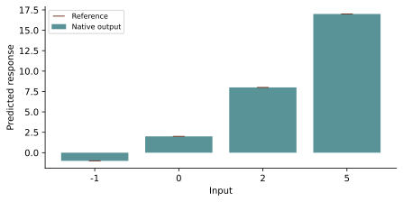

# Matrix division and least squares

Follow a feature that shapes how this language is used in practice.

Work with a small fixture so that every returned value can be checked by hand. Keep the ordering of inputs visible. Trace resource ownership, data shape or scheduling as appropriate, and identify the exact point where the result becomes available to the caller.

A two-column design carries the intercept and slope. Left division solves the least-squares system directly, and matrix multiplication transfers the coefficients to new rows.

[Worked notebook](lesson.ipynb) · [Python script](lesson.py)

[native.m](native.m)

## Execute the native listing

A two-column design carries the intercept and slope. Left division solves the least-squares system directly, and matrix multiplication transfers the coefficients to new rows. Write down each array shape and distinguish element-wise arithmetic from matrix operations. The source uses the common MATLAB and GNU Octave language subset.

## Read the output

The independent calculation describes the expected output. Its agreement with the native result tests both the values and their order. The marks show the independent Python reference at each position.

## Recorded output

```text
Runtime: GNU Octave (MATLAB-compatible source)
Native stdout: -1 2 8 17
Largest absolute difference: 0
```

## Interpreting the result

The independent calculation describes the expected output. Its agreement with the native result tests both the values and their order.



## Exercise

Change the input length, add a repeated value and predict all output positions before running the programme.

## References

[MathWorks, MATLAB language fundamentals](https://www.mathworks.com/help/matlab/language-fundamentals.html)

[GNU Octave manual](https://docs.octave.org/latest/)
