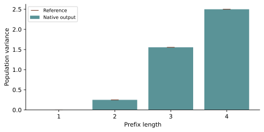

# Online variance and testing

Compute the population variance after each reading without losing its small variation around a large baseline.

The raw second moment minus the squared mean is mathematically correct but can cancel numerically. Welford updates a running mean and a sum of squared deviations. A two-pass calculation on each short prefix gives a separate check. The population denominator is the prefix length. A sample variance would use one fewer and be undefined on the first observation.

A row vector is traversed one column per iteration in a for loop. Changing it to a column requires a different loop to process scalars.

[Worked notebook](lesson.ipynb) · [Python script](lesson.py)

[native.m](native.m)

## Execute the native listing

A row vector is traversed one column per iteration in a for loop. Changing it to a column requires a different loop to process scalars. Write down each array shape and distinguish element-wise arithmetic from matrix operations. The source uses the common MATLAB and GNU Octave language subset.

## Read the output

The first variance is zero. Subsequent variances describe the spread seen so far, and shifting every input by a constant preserves them in exact arithmetic. The marks show the independent Python reference at each position.

## Recorded output

```text
Runtime: GNU Octave (MATLAB-compatible source)
Native stdout: 0 0.25 1.55555552244 2.4999999553
Largest absolute difference: 4.47e-08
```

## Interpreting the result

The first variance is zero. Subsequent variances describe the spread seen so far, and shifting every input by a constant preserves them in exact arithmetic.



## Exercise

Subtract the billion-unit offset and compare the reported variances. Then implement the raw-moment formula and inspect its rounding error.

## References

[MathWorks, MATLAB language fundamentals](https://www.mathworks.com/help/matlab/language-fundamentals.html)

[Welford, corrected sums of squares (1962)](https://doi.org/10.1080/00401706.1962.10490022)

[GNU Octave manual](https://docs.octave.org/latest/)
