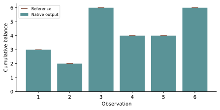

# Collections and prefix sums

Keep the balance after every signed change, including a negative change and a zero.

After processing position i, the state equals the sum of the first i changes. That invariant gives a proof by induction and a simple reference implementation. A one-pass algorithm costs linear time. Computing each prefix separately costs quadratic time but is convenient for checking six short observations.

itertools.accumulate returns an iterator. The original changes remain available after the balances are consumed.

[Worked notebook](lesson.ipynb) · [Python script](lesson.py)

[native.py](native.py)

## Execute the native listing

itertools.accumulate returns an iterator. The original changes remain available after the balances are consumed. Python evaluates the iterator when the caller asks for its next item. Put the break point inside the loop when inspecting a lazy calculation.

## Read the output

A flat section corresponds to a zero change. The final balance must equal the sum of the full input even when earlier balances fall. The marks show the independent Python reference at each position.

## Recorded output

```text
Runtime: Python
Native stdout: 3 2 6 4 4 6
Largest absolute difference: 0
```

## Interpreting the result

A flat section corresponds to a zero change. The final balance must equal the sum of the full input even when earlier balances fall.



## Exercise

Insert a negative change at the start. Verify both the prefix values and the final-sum property.

## References

[Python language tutorial](https://docs.python.org/3/tutorial/)
