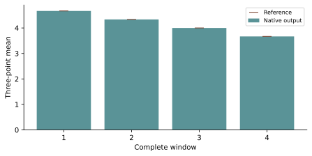

# Generators and sliding windows

Follow a feature that shapes how this language is used in practice.

Work with a small fixture so that every returned value can be checked by hand. Keep the ordering of inputs visible. Trace resource ownership, data shape or scheduling as appropriate, and identify the exact point where the result becomes available to the caller.

A deque retains at most three active values. yield exposes one completed window while keeping the running total between calls.

[Worked notebook](lesson.ipynb) · [Python script](lesson.py)

[native.py](native.py)

## Execute the native listing

A deque retains at most three active values. yield exposes one completed window while keeping the running total between calls. Python evaluates the iterator when the caller asks for its next item. Put the break point inside the loop when inspecting a lazy calculation.

## Read the output

The independent calculation describes the expected output. Its agreement with the native result tests both the values and their order. The marks show the independent Python reference at each position.

## Recorded output

```text
Runtime: Python
Native stdout: 4.666666666666667 4.333333333333333 4.0 3.6666666666666665
Largest absolute difference: 0
```

## Interpreting the result

The independent calculation describes the expected output. Its agreement with the native result tests both the values and their order.



## Exercise

Change the input length, add a repeated value and predict all output positions before running the programme.

## References

[Python language tutorial](https://docs.python.org/3/tutorial/)
