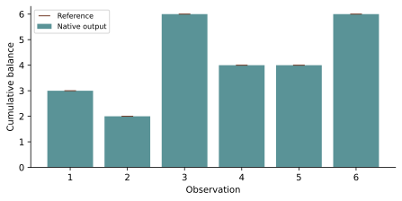

# Collections and prefix sums

Keep the balance after every signed change, including a negative change and a zero.

After processing position i, the state equals the sum of the first i changes. That invariant gives a proof by induction and a simple reference implementation. A one-pass algorithm costs linear time. Computing each prefix separately costs quadratic time but is convenient for checking six short observations.

cumsum returns one result per input. tail extracts the final total and stopifnot checks a property of the vector.

[Worked notebook](lesson.ipynb) · [Python script](lesson.py)

[native.R](native.R)

## Execute the native listing

cumsum returns one result per input. tail extracts the final total and stopifnot checks a property of the vector. Inspect the object with str() before transforming it. Type, names, dimensions and missingness can all affect how an expression is evaluated.

## Read the output

A flat section corresponds to a zero change. The final balance must equal the sum of the full input even when earlier balances fall. The marks show the independent Python reference at each position.

## Recorded output

```text
Runtime: R
Native stdout: 3 2 6 4 4 6
Largest absolute difference: 0
```

## Interpreting the result

A flat section corresponds to a zero change. The final balance must equal the sum of the full input even when earlier balances fall.



## Exercise

Insert a negative change at the start. Verify both the prefix values and the final-sum property.

## References

[R Core Team, An Introduction to R](https://cran.r-project.org/doc/manuals/r-release/R-intro.html)
