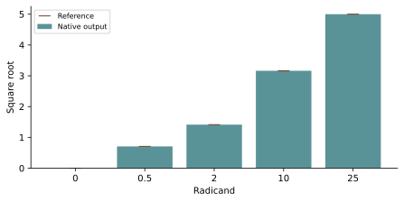

# Bisection and numerical functions

Approximate square roots by repeatedly halving a bracket.

For positive n, the target root lies in [0, max(1,n)]. The square is monotone there, so the comparison with n selects the half that still contains the root. Each exact-arithmetic iteration halves the interval width. In floating-point arithmetic two endpoints eventually round to the same value. Zero has a simple exact answer.

vapply specifies the result shape and type expected from each call. A scalar function keeps the bracket invariant easy to inspect.

[Worked notebook](lesson.ipynb) · [Python script](lesson.py)

[native.R](native.R)

## Execute the native listing

vapply specifies the result shape and type expected from each call. A scalar function keeps the bracket invariant easy to inspect. Inspect the object with str() before transforming it. Type, names, dimensions and missingness can all affect how an expression is evaluated.

## Read the output

Accuracy should be checked against an independent implementation on both sides of one. A fixed number of bisection steps is adequate for this small range. The marks show the independent Python reference at each position.

## Recorded output

```text
Runtime: R
Native stdout: 0.0000000000 0.7071067812 1.4142135624 3.1622776602 5.0000000000
Largest absolute difference: 3.16e-11
```

## Interpreting the result

Accuracy should be checked against an independent implementation on both sides of one. A fixed number of bisection steps is adequate for this small range.



## Exercise

Test 0.01, 1 and a larger value. Replace the fixed iteration count with an absolute or relative tolerance and justify the stopping condition.

## References

[R Core Team, An Introduction to R](https://cran.r-project.org/doc/manuals/r-release/R-intro.html)
