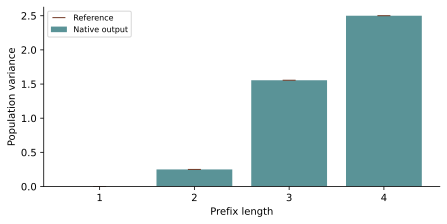

# Online variance and testing

Compute the population variance after each reading without losing its small variation around a large baseline.

The raw second moment minus the squared mean is mathematically correct but can cancel numerically. Welford updates a running mean and a sum of squared deviations. A two-pass calculation on each short prefix gives a separate check. The population denominator is the prefix length. A sample variance would use one fewer and be undefined on the first observation.

R doubles have finite precision. Centring each update avoids subtracting two large, nearly equal estimates.

[Worked notebook](lesson.ipynb) · [Python script](lesson.py)

[native.R](native.R)

## Execute the native listing

R doubles have finite precision. Centring each update avoids subtracting two large, nearly equal estimates. Inspect the object with str() before transforming it. Type, names, dimensions and missingness can all affect how an expression is evaluated.

## Read the output

The first variance is zero. Subsequent variances describe the spread seen so far, and shifting every input by a constant preserves them in exact arithmetic. The marks show the independent Python reference at each position.

## Recorded output

```text
Runtime: R
Native stdout: 0.0000000000 0.2500000000 1.5555555224 2.4999999553
Largest absolute difference: 4.47e-08
```

## Interpreting the result

The first variance is zero. Subsequent variances describe the spread seen so far, and shifting every input by a constant preserves them in exact arithmetic.



## Exercise

Subtract the billion-unit offset and compare the reported variances. Then implement the raw-moment formula and inspect its rounding error.

## References

[R Core Team, An Introduction to R](https://cran.r-project.org/doc/manuals/r-release/R-intro.html)

[Welford, corrected sums of squares (1962)](https://doi.org/10.1080/00401706.1962.10490022)
