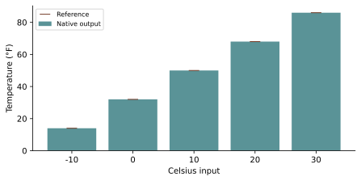

# Values and numeric types

Convert five readings from Celsius to Fahrenheit and examine where arithmetic changes type.

The offset belongs after multiplication by the scale factor. Check the freezing point by hand, then inspect a value that would expose early integer division. All plotted points share the same transformation, so equal increments on the input scale must give equal increments on the output scale.

A typed integer array is consumed by the loop. f64::from converts each value before fractional arithmetic.

[Worked notebook](lesson.ipynb) · [Python script](lesson.py)

[native.rs](native.rs)

## Execute the native listing

A typed integer array is consumed by the loop. f64::from converts each value before fractional arithmetic. Read the type and ownership information at the function boundary. A borrowed slice permits access to existing storage while the owner retains responsibility for its lifetime.

## Read the output

A straight line is expected. The intercept is 32 and a ten-degree Celsius step adds 18 degrees Fahrenheit. The marks show the independent Python reference at each position.

## Recorded output

```text
Runtime: Rust
Native stdout: 14 32 50 68 86
Largest absolute difference: 0
```

## Interpreting the result

A straight line is expected. The intercept is 32 and a ten-degree Celsius step adds 18 degrees Fahrenheit.



## Exercise

Add −40 and a fractional Celsius reading. Describe any type change needed by the native programme.

## References

[The Rust Programming Language](https://doc.rust-lang.org/book/)
