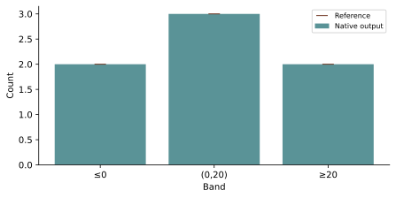

# Control flow and boundary cases

Assign each observation to a band, including the observations exactly on a boundary.

Use three disjoint intervals. Values at or below zero enter the first band. Positive values below 20 enter the second. Everything at or above 20 enters the last band. Summing the band counts gives a conservation check that catches dropped observations, although it cannot by itself detect a misplaced observation.

Pattern matching assigns a band. The wildcard makes the match exhaustive over the integer domain.

[Worked notebook](lesson.ipynb) · [Python script](lesson.py)

[native.rs](native.rs)

## Execute the native listing

Pattern matching assigns a band. The wildcard makes the match exhaustive over the integer domain. Read the type and ownership information at the function boundary. A borrowed slice permits access to existing storage while the owner retains responsibility for its lifetime.

## Read the output

Read each bar as a count. A boundary convention is part of the specification and should be stated before choosing the test inputs. The marks show the independent Python reference at each position.

## Recorded output

```text
Runtime: Rust
Native stdout: 2 3 2
Largest absolute difference: 0
```

## Interpreting the result

Read each bar as a count. A boundary convention is part of the specification and should be stated before choosing the test inputs.



## Exercise

Add values 19 and 20, then predict which two bars change. Test a list that leaves a category empty.

## References

[The Rust Programming Language](https://doc.rust-lang.org/book/)
