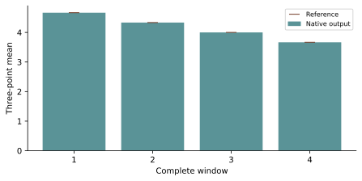

# Borrowed windows and iterator lifetimes

Follow a feature that shapes how this language is used in practice.

Work with a small fixture so that every returned value can be checked by hand. Keep the ordering of inputs visible. Trace resource ownership, data shape or scheduling as appropriate, and identify the exact point where the result becomes available to the caller.

windows returns slices into the original allocation. The returned iterator borrows the input for its own lifetime. Each window is reduced without copying its elements.

[Worked notebook](lesson.ipynb) · [Python script](lesson.py)

[native.rs](native.rs)

## Execute the native listing

windows returns slices into the original allocation. The returned iterator borrows the input for its own lifetime. Each window is reduced without copying its elements. Read the type and ownership information at the function boundary. A borrowed slice permits access to existing storage while the owner retains responsibility for its lifetime.

## Read the output

The independent calculation describes the expected output. Its agreement with the native result tests both the values and their order. The marks show the independent Python reference at each position.

## Recorded output

```text
Runtime: Rust
Native stdout: 4.666666666666667 4.333333333333333 4 3.6666666666666665
Largest absolute difference: 0
```

## Interpreting the result

The independent calculation describes the expected output. Its agreement with the native result tests both the values and their order.



## Exercise

Change the input length, add a repeated value and predict all output positions before running the programme.

## References

[The Rust Programming Language](https://doc.rust-lang.org/book/)
