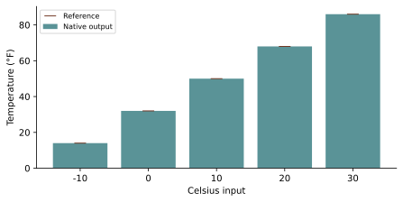

# Values and numeric types

Convert five readings from Celsius to Fahrenheit and examine where arithmetic changes type.

The offset belongs after multiplication by the scale factor. Check the freezing point by hand, then inspect a value that would expose early integer division. All plotted points share the same transformation, so equal increments on the input scale must give equal increments on the output scale.

VALUES defines the finite input relation. An explicit ORDER BY gives the reference result a deterministic order.

[Worked notebook](lesson.ipynb) · [Python script](lesson.py)

[native.sql](native.sql)

## Execute the native listing

VALUES defines the finite input relation. An explicit ORDER BY gives the reference result a deterministic order. Write down the grain of the result: what does one row represent? Aggregation changes the grain, whereas a window function can attach a result to each input row.

## Read the output

A straight line is expected. The intercept is 32 and a ten-degree Celsius step adds 18 degrees Fahrenheit. The marks show the independent Python reference at each position.

## Recorded output

```text
Runtime: SQLite
Native stdout: 14.0 32.0 50.0 68.0 86.0
Largest absolute difference: 0
```

## Interpreting the result

A straight line is expected. The intercept is 32 and a ten-degree Celsius step adds 18 degrees Fahrenheit.



## Exercise

Add −40 and a fractional Celsius reading. Describe any type change needed by the native programme.

## References

[SQLite, SQL language documentation](https://sqlite.org/lang.html)

[SQLite, window frames](https://sqlite.org/windowfunctions.html)
