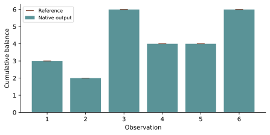

# Collections and prefix sums

Keep the balance after every signed change, including a negative change and a zero.

After processing position i, the state equals the sum of the first i changes. That invariant gives a proof by induction and a simple reference implementation. A one-pass algorithm costs linear time. Computing each prefix separately costs quadratic time but is convenient for checking six short observations.

The frame ROWS BETWEEN UNBOUNDED PRECEDING AND CURRENT ROW includes the current observation and its predecessors in position order.

[Worked notebook](lesson.ipynb) · [Python script](lesson.py)

[native.sql](native.sql)

## Execute the native listing

The frame ROWS BETWEEN UNBOUNDED PRECEDING AND CURRENT ROW includes the current observation and its predecessors in position order. Write down the grain of the result: what does one row represent? Aggregation changes the grain, whereas a window function can attach a result to each input row.

## Read the output

A flat section corresponds to a zero change. The final balance must equal the sum of the full input even when earlier balances fall. The marks show the independent Python reference at each position.

## Recorded output

```text
Runtime: SQLite
Native stdout: 3 2 6 4 4 6
Largest absolute difference: 0
```

## Interpreting the result

A flat section corresponds to a zero change. The final balance must equal the sum of the full input even when earlier balances fall.



## Exercise

Insert a negative change at the start. Verify both the prefix values and the final-sum property.

## References

[SQLite, SQL language documentation](https://sqlite.org/lang.html)

[SQLite, window frames](https://sqlite.org/windowfunctions.html)
