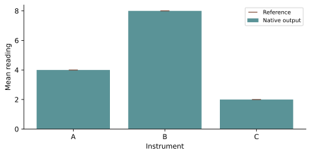

# Records and missing values

Compute mean readings by instrument while retaining the difference between zero and an absent reading.

Define the unit of observation before grouping. Each row is one reading from one instrument. The correct denominator is the number of observed values for that instrument. A measurement of zero belongs in that denominator. The result is ordered by identifier so it can be compared independently of map iteration order.

A left join preserves the reference identifiers. AVG excludes NULL values and returns NULL for a group without any observed values.

[Worked notebook](lesson.ipynb) · [Python script](lesson.py)

[native.sql](native.sql)

## Execute the native listing

A left join preserves the reference identifiers. AVG excludes NULL values and returns NULL for a group without any observed values. Write down the grain of the result: what does one row represent? Aggregation changes the grain, whereas a window function can attach a result to each input row.

## Read the output

Instrument B has one observed value and one missing value. Its average stays at eight. An empty instrument would need an explicit missing-output convention. The marks show the independent Python reference at each position.

## Recorded output

```text
Runtime: SQLite
Native stdout: 4.0 8.0 2.0
Largest absolute difference: 0
```

## Interpreting the result

Instrument B has one observed value and one missing value. Its average stays at eight. An empty instrument would need an explicit missing-output convention.



## Exercise

Add a genuine zero to B and a new instrument with no observed values. Decide on a representation for the empty result.

## References

[SQLite, SQL language documentation](https://sqlite.org/lang.html)

[SQLite, window frames](https://sqlite.org/windowfunctions.html)
