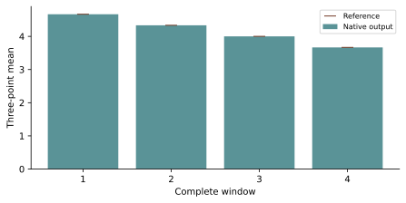

# Window frames and rolling averages

Follow a feature that shapes how this language is used in practice.

Work with a small fixture so that every returned value can be checked by hand. Keep the ordering of inputs visible. Trace resource ownership, data shape or scheduling as appropriate, and identify the exact point where the result becomes available to the caller.

A bounded ROWS frame includes the current row and its two predecessors. A second query filters incomplete frames after the window functions have been evaluated.

[Worked notebook](lesson.ipynb) · [Python script](lesson.py)

[native.sql](native.sql)

## Execute the native listing

A bounded ROWS frame includes the current row and its two predecessors. A second query filters incomplete frames after the window functions have been evaluated. Write down the grain of the result: what does one row represent? Aggregation changes the grain, whereas a window function can attach a result to each input row.

## Read the output

The independent calculation describes the expected output. Its agreement with the native result tests both the values and their order. The marks show the independent Python reference at each position.

## Recorded output

```text
Runtime: SQLite
Native stdout: 4.666666666666667 4.333333333333333 4.0 3.6666666666666665
Largest absolute difference: 0
```

## Interpreting the result

The independent calculation describes the expected output. Its agreement with the native result tests both the values and their order.



## Exercise

Change the input length, add a repeated value and predict all output positions before running the programme.

## References

[SQLite, SQL language documentation](https://sqlite.org/lang.html)

[SQLite, window frames](https://sqlite.org/windowfunctions.html)
