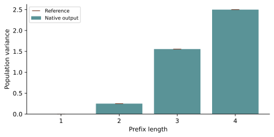

# Online variance and testing

Compute the population variance after each reading without losing its small variation around a large baseline.

The raw second moment minus the squared mean is mathematically correct but can cancel numerically. Welford updates a running mean and a sum of squared deviations. A two-pass calculation on each short prefix gives a separate check. The population denominator is the prefix length. A sample variance would use one fewer and be undefined on the first observation.

Join each prefix to its centred mean and aggregate squared deviations. This two-pass SQL reference computes the same quantity as Welford at every prefix.

[Worked notebook](lesson.ipynb) · [Python script](lesson.py)

[native.sql](native.sql)

## Execute the native listing

Join each prefix to its centred mean and aggregate squared deviations. This two-pass SQL reference computes the same quantity as Welford at every prefix. Write down the grain of the result: what does one row represent? Aggregation changes the grain, whereas a window function can attach a result to each input row.

## Read the output

The first variance is zero. Subsequent variances describe the spread seen so far, and shifting every input by a constant preserves them in exact arithmetic. The marks show the independent Python reference at each position.

## Recorded output

```text
Runtime: SQLite
Native stdout: 0.0 0.25 1.5555555555555571 2.5
Largest absolute difference: 1.55e-15
```

## Interpreting the result

The first variance is zero. Subsequent variances describe the spread seen so far, and shifting every input by a constant preserves them in exact arithmetic.



## Exercise

Subtract the billion-unit offset and compare the reported variances. Then implement the raw-moment formula and inspect its rounding error.

## References

[SQLite, SQL language documentation](https://sqlite.org/lang.html)

[Welford, corrected sums of squares (1962)](https://doi.org/10.1080/00401706.1962.10490022)

[SQLite, window frames](https://sqlite.org/windowfunctions.html)
